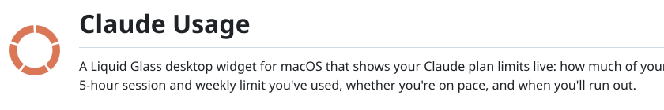
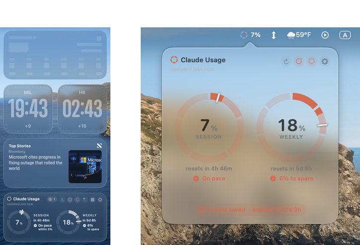

<picture>
  <source media="(prefers-color-scheme: dark)" srcset="docs/images/header-dark.svg">
  
</picture>

<p><a href="../../releases/latest/download/ClaudeUsage.zip"><picture><source media="(prefers-color-scheme: dark)" srcset="docs/images/download-dark.svg"></picture><b>Download ClaudeUsage.zip</b></a> &nbsp;·&nbsp; macOS 26+ &nbsp;·&nbsp; Apple Silicon &amp; Intel</p>

<p><b>Unofficial.</b> This app is not made by, affiliated with, or endorsed by Anthropic.</p>

## Features

<picture>
  <source media="(prefers-color-scheme: dark)" srcset="docs/images/features-dark.png">
  
</picture>

- **Run-out forecast**: know when you'll hit a limit at your current pace
- **Weekly budget**: even days, weekdays only, or your own split
- **Your own alerts**: get notified at the percentages you pick
- **Today by the hour**: see when you use Claude most
- **Menu bar gauge**: your usage at a glance
- **Three sizes**: small, medium and large
- **Feels native**: Liquid Glass, light and dark, and it fades like real widgets<br>

## Install

You'll need **macOS 26** or later and **[Claude Code](https://claude.com/claude-code)** logged in. That's it: no account or keys to set up.

1. **[Download ClaudeUsage.zip](../../releases/latest/download/ClaudeUsage.zip)**, unzip it, and drag the app into **Applications**.
2. The first time, **right-click the app → Open**, then **Open** again.
3. When macOS asks about **"Claude Code-credentials"**, click **Always Allow**.

<details>
<summary>Only seeing "Move to Bin"? Want it to start at login?</summary>

- **"Move to Bin" only:** go to **System Settings → Privacy & Security**, scroll down, and click **Open Anyway**. This happens because the app isn't from the App Store.
- **Start at login:** System Settings → General → Login Items → **+** → choose ClaudeUsage.

</details>

## Make it yours

Hover over the widget to show its buttons, and click the **gear** for Settings: theme, size, ring style, weekly budget, alerts and more.

<p align="center">
  
  
  
</p>

## Privacy

No account, no server, no tracking. It uses your Claude Code login **only** to ask Anthropic's own API for your usage, and everything stays on your Mac.

<details>
<summary>Privacy, disclaimer and liability in full</summary>

**Unofficial app.** Claude Usage is an independent, unofficial project. It is not made by, affiliated with, or endorsed by Anthropic. "Claude" and "Anthropic" are trademarks of Anthropic, PBC, used here only to describe what the app shows.

**Your data stays on this Mac.** There is no server of ours, no account, no analytics and no tracking. The app reads your existing Claude Code login from the macOS Keychain and uses it only to ask Anthropic's own API (`api.anthropic.com`) for your usage. The login token is never saved, logged or sent anywhere else.

**What's stored locally.** Your settings, saved-reset count and expiry, and today's hourly usage are kept in this Mac's app preferences. Nothing leaves your Mac except that one usage request to Anthropic.

**Accuracy.** Usage comes from an undocumented Anthropic endpoint that may change or stop working. Forecasts are estimates. Check Settings → Usage on claude.ai for the official figures.

**No warranty.** Provided "as is", without warranty of any kind, express or implied, including accuracy, reliability or fitness for a particular purpose. See the [MIT license](LICENSE).

**Limitation of liability.** To the fullest extent permitted by law, the authors are not liable for any loss or damage arising from using this app, including: inaccurate, delayed or missing usage figures or forecasts; missed, late or incorrect alerts and reminders; reaching or exceeding Claude usage limits; unused or expired saved resets; lost work, data or settings; or any charges, restrictions or account issues with Anthropic. You use it entirely at your own risk.

</details>

<details>
<summary>Troubleshooting</summary>

| Message | Fix |
|---|---|
| *Claude Code login not found* | Install Claude Code and log in, then press ↻ |
| *Login expired* | Use Claude Code once; the widget picks up the new login by itself |
| *Updates paused · retrying…* | Anthropic asked the widget to slow down. Your last numbers stay on screen and it retries on its own |
| No notifications | System Settings → Notifications → ClaudeUsage → allow |

</details>

<details>
<summary>Build from source</summary>

Requires the Xcode Command Line Tools (`xcode-select --install`).

```sh
./build.sh            # build into ./build
./build.sh install    # build, install to ~/Applications, start at login
./build.sh dist       # universal build + zip in ./dist
```

</details>

---

<sub>[MIT license](LICENSE) · Unofficial; not affiliated with Anthropic.</sub>
