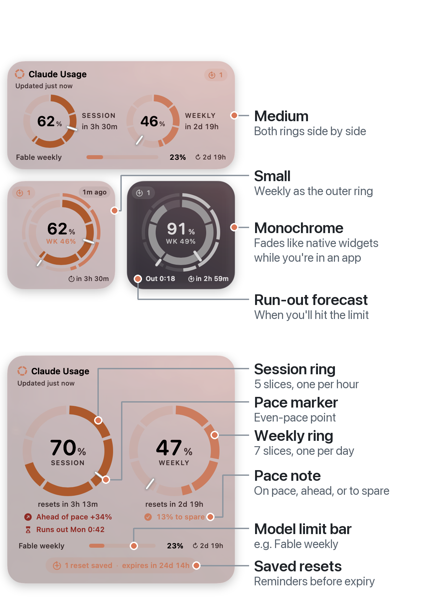
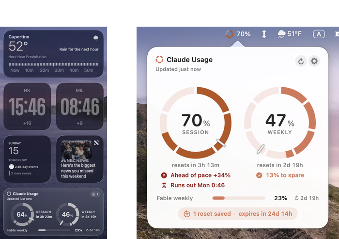
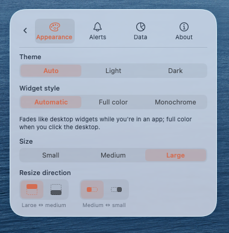
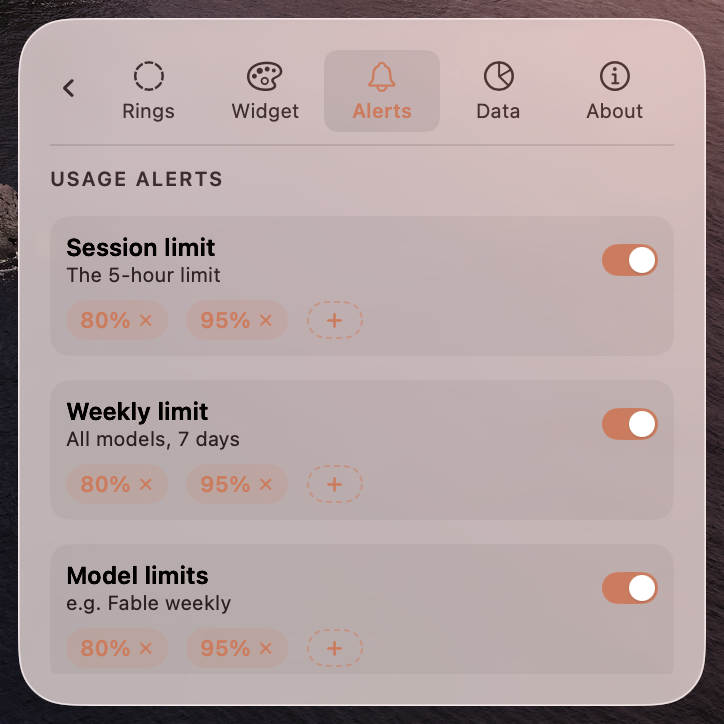
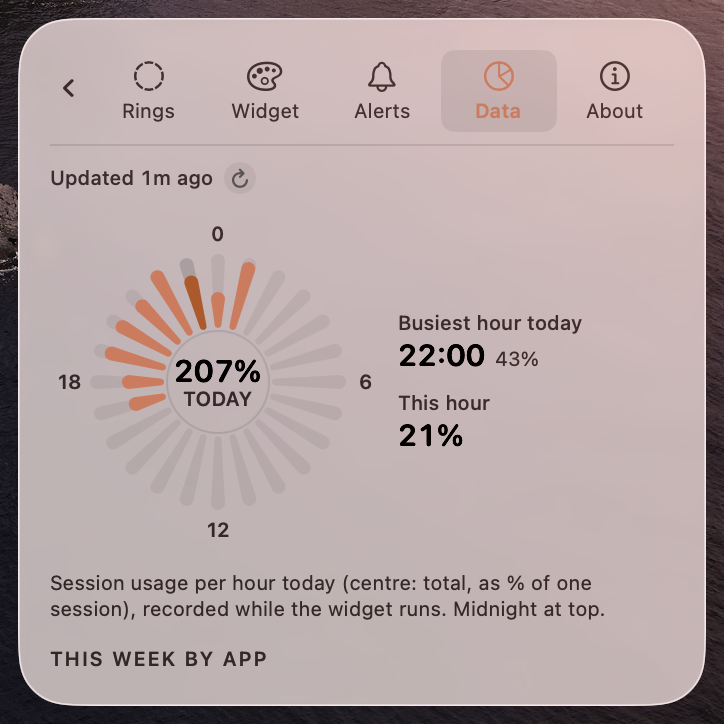

<picture>
  <source media="(prefers-color-scheme: dark)" srcset="docs/images/header-dark.svg">
  
</picture>

<p><a href="../../releases/latest/download/ClaudeUsage.zip"><picture><source media="(prefers-color-scheme: dark)" srcset="docs/images/download-dark.svg"></picture><b>Download ClaudeUsage.zip</b></a> &nbsp;·&nbsp; macOS 26+ &nbsp;·&nbsp; Apple Silicon &amp; Intel</p>

<p><b>Unofficial.</b> This app is not made by, affiliated with, or endorsed by Anthropic.</p>

## Features

<picture>
  <source media="(prefers-color-scheme: dark)" srcset="docs/images/features-dark.png">
  
</picture>

- **Run-out forecast**: know when you'll hit a limit at your current pace
- **Weekly budget**: even days, weekdays only, or your own split
- **Your own alerts**: get notified at the percentages you pick
- **Today by the hour**: see when you use Claude most
- **Menu bar gauge**: your usage at a glance
- **Three sizes**: small, medium and large
- **Feels native**: Liquid Glass, light and dark, and it fades like real widgets<br>

## Install

You'll need **macOS 26** or later and **[Claude Code](https://claude.com/claude-code)** logged in. That's it: no account or keys to set up.

### Quick install (Terminal)

```sh
curl -fsSL https://raw.githubusercontent.com/wilsongrchan/claude-usage-widget/main/install.sh | bash
```

The [script](install.sh) only downloads the same ClaudeUsage.zip as the link below and copies the app into Applications, so macOS won't show an "Apple could not verify" warning. Run it again any time to update.

### Manual install

1. **[Download ClaudeUsage.zip](../../releases/latest/download/ClaudeUsage.zip)**, unzip it, drag the app into **Applications** and open it. macOS says Apple could not verify it: click **Done**.
2. Open **System Settings → Privacy & Security**, scroll down and click **Open Anyway**.
3. Click **Open Anyway** again and enter your password. You only do this once.
4. The welcome window walks you through the rest: connecting to Claude Code, notifications and Open at Login.

<details>
<summary>Prefer Terminal for step 2? Wondering what to click on the Keychain prompt?</summary>

- **Skip steps 1–3:** after dragging the app into Applications, run `xattr -dr com.apple.quarantine "/Applications/Claude Usage.app"`, then open it normally.
- **Keychain prompt:** macOS asks whether "security" may use **"Claude Code-credentials"**. That's how the app reads your Claude Code login. **Always Allow** stops macOS asking again, but it also lets other software on this Mac read that login through the same system tool. **Allow** asks again each time the app re-reads the login (at launch, and when Claude Code renews its login).

</details>

<details>
<summary>Uninstall</summary>

1. Quit it: the X on the widget → **Quit Claude Usage** (or Settings → About → Quit).
2. Drag **Claude Usage** from Applications to the **Trash**. Turn off Open at Login first if you had it on.
3. Optional, to remove its settings too: `defaults delete local.claude-usage-widget`

</details>

## Make it yours

Hover over the widget for its five buttons: refresh, the two other sizes, the **gear** for Settings and the X. Or right-click it (or the menu bar gauge) for the same things in a menu. Settings open at large size, whatever size the widget is, and it goes back when you're done: Rings (pace marker, slices, weekly budget, notes), Widget (theme, color style, size), Alerts, Data and About.

<p align="center">
  
  
  
</p>

## Privacy

No account, no server, no tracking. It uses your Claude Code login **only** to ask Anthropic's own API for your usage, and everything stays on your Mac.

<details>
<summary>Privacy, disclaimer and liability in full</summary>

**Unofficial app.** Claude Usage is an independent, unofficial project. It is not made by, affiliated with, or endorsed by Anthropic. "Claude" and "Anthropic" are trademarks of Anthropic, PBC, used here only to describe what the app shows.

**Your data stays on this Mac.** There is no server of ours, no account, no analytics and no tracking. The app reads your existing Claude Code login from the macOS Keychain and uses it only to ask Anthropic's own API (`api.anthropic.com`) for your usage. The login token is never saved, logged or sent anywhere else. Separately, once a day it asks GitHub whether a newer version is out; that request carries no personal data, and you can turn it off in Alerts.

**What's stored locally.** Your settings, saved-reset count and expiry, and today's hourly usage are kept in this Mac's app preferences. Nothing leaves your Mac except that usage request to Anthropic and the daily update check with GitHub.

**Accuracy.** Usage comes from an undocumented Anthropic endpoint that may change or stop working. Forecasts are estimates. Check Settings → Usage on claude.ai for the official figures.

**No warranty.** Provided "as is", without warranty of any kind, express or implied, including accuracy, reliability or fitness for a particular purpose. See the [MIT license](LICENSE).

**Limitation of liability.** To the fullest extent permitted by law, the authors are not liable for any loss or damage arising from using this app, including: inaccurate, delayed or missing usage figures or forecasts; missed, late or incorrect alerts and reminders; reaching or exceeding Claude usage limits; unused or expired saved resets; lost work, data or settings; or any charges, restrictions or account issues with Anthropic. You use it entirely at your own risk.

</details>

<details>
<summary>Troubleshooting</summary>

| Message | Fix |
|---|---|
| *Claude Code not found* | Install Claude Code and log in, then press ↻ |
| *Keychain access denied* | You clicked Deny on the Keychain prompt. Press ↻ and choose **Allow** or **Always Allow** this time |
| *Login expired* | Use Claude Code once; the widget picks up the new login by itself |
| *Updates paused · retrying…* | Anthropic asked the widget to slow down. Your last numbers stay on screen and it retries on its own |
| No notifications | System Settings → Notifications → Claude Usage → allow |

</details>

<details>
<summary>Build from source</summary>

Requires the Xcode Command Line Tools (`xcode-select --install`).

```sh
./build.sh            # build into ./build
./build.sh install    # build, install to ~/Applications and open it
./build.sh dist       # universal build + zip in ./dist
./build.sh test       # run the tests
```

The version comes from the latest git tag, or set it with `VERSION=1.2.3 ./build.sh dist`. See [RELEASING.md](RELEASING.md) for how releases are made.

</details>

---

<sub>[MIT license](LICENSE) · Unofficial; not affiliated with Anthropic.</sub>
