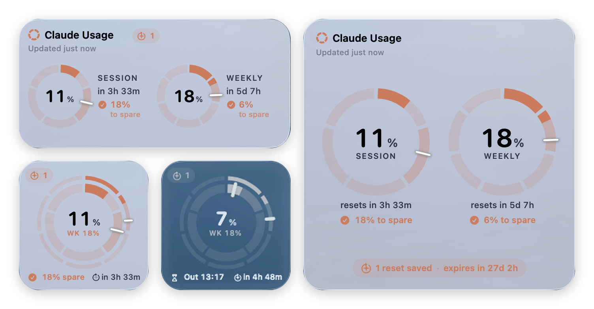
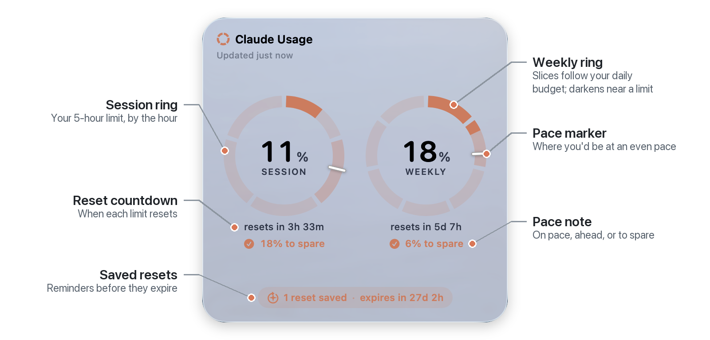
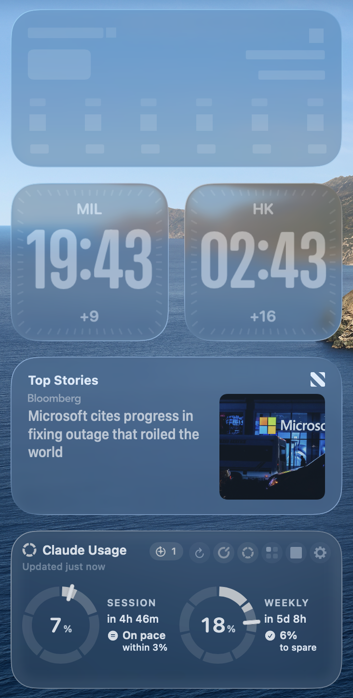
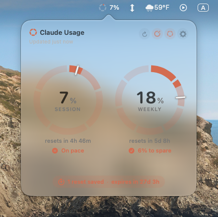
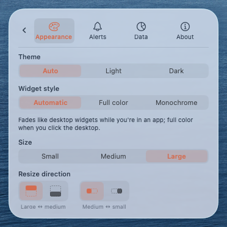
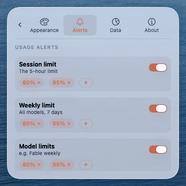
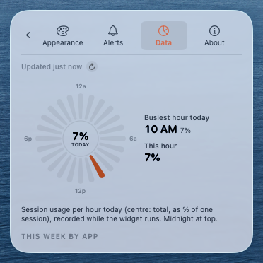

<p align="center">
  
</p>

<h1 align="center">Claude Usage</h1>

<p align="center">
  A Liquid Glass desktop widget for macOS that shows your Claude plan limits live:<br>
  how much of your 5-hour session and weekly limit you've used, whether you're on pace, and when you'll run out.
</p>

<p align="center">
  <a href="../../releases/latest/download/ClaudeUsage.zip"><b>⬇︎ Download ClaudeUsage.zip</b></a>
  &nbsp;·&nbsp; macOS 26+ &nbsp;·&nbsp; Apple Silicon &amp; Intel
</p>

> **Unofficial.** This app is not made by, affiliated with, or endorsed by Anthropic.

<p align="center">
  
</p>

## Features

<p align="center">
  <picture>
    <source media="(prefers-color-scheme: dark)" srcset="docs/images/features-dark.png">
    
  </picture>
</p>



- **Run-out forecast.** When you're ahead of pace, it estimates when you'll hit the limit, for example "Runs out 4:10 PM".
- **Weekly budgeting.** Split the weekly ring into 7 even days, 5 weekdays, or your own percentage for each day (say, more on Monday and less on the weekend). The pace marker follows your plan.
- **Alerts you set yourself.** Notifications at 80% and 95% by default, set separately for session, weekly and model limits. Add as many thresholds as you like.
- **Today by the hour.** A spark-shaped chart of which hours of today you used Claude most, plus a weekly split by app (Claude Code vs. chat).
- **Menu bar gauge.** A tiny ring and percentage in the menu bar. Click it for the full widget.
- **Three sizes.** Small (1 slot), medium (2×1, landscape) and large (2×2). Switching sizes animates smoothly, and you choose which way it grows and shrinks.
- **Feels native.** Liquid Glass, light and dark themes, the same rounded corners as macOS widgets, and a translucent monochrome look while you're in other apps. It snaps to the same grid as your desktop widgets and keeps out of their way.

<br clear="right">

<p align="center">
  
</p>

<p align="center">
  
  
  
</p>

## Install

**You need:** macOS 26 (Tahoe) or later, and [Claude Code](https://claude.com/claude-code) installed and logged in. The widget reads your usage with that login, so there's nothing else to set up.

1. **[Download ClaudeUsage.zip](../../releases/latest/download/ClaudeUsage.zip)** and double-click it to unzip.
2. Drag **ClaudeUsage.app** into your **Applications** folder.
3. **Open it the first time** by right-clicking (or Control-clicking) the app and choosing **Open**, then **Open** again.
   If macOS only offers "Move to Bin", go to **System Settings → Privacy & Security**, scroll down, and click **Open Anyway**.
   *(This happens because the app isn't distributed through the App Store.)*
4. When macOS asks to use **"Claude Code-credentials"** from your keychain, click **Always Allow**.
5. The widget appears on your desktop. Drag it anywhere and it snaps into place.

**Start at login (optional):** System Settings → General → Login Items → **+** → choose ClaudeUsage.

## Using it

| | |
|---|---|
| **Left ring** | 5-hour session limit (split into 5 hourly slices) |
| **Right ring** | Weekly limit (split into daily slices, following your budget) |
| **White tick** | Where you'd be at an even pace. Arc past the tick means you're using it fast |
| **↻** (top right) | Refresh now |
| **Ring icons** | Show or hide the pace marker, and switch between segmented and solid rings |
| **Size buttons** | Switch to either of the other two sizes (the icon shows which grid cells it fills) |
| **Gear** | Settings |
| **Reset chip** (bottom) | Saved resets and when they expire. Click to edit |

The buttons appear when you hover over the widget. Hover over a button to see its name.

Ahead of pace, the widget also forecasts when you'll run out, for example "Runs out 18:10" or "Runs out Tue 9 AM" (following your Mac's 12/24-hour setting).

## Customize

Click the **gear** to open Settings.

**Appearance**

| Setting | Options |
|---|---|
| Theme | Auto · Light · Dark |
| Widget style | Automatic (fades like desktop widgets while you're in an app) · Full color · Monochrome |
| Size | Small (1×1) · Medium (2×1) · Large (2×2) |
| Resize direction | Large ↔ medium grows/shrinks up or down; medium ↔ small left or right |
| Pace marker | On / off |
| Segmented rings | On / off |
| Weekly ring slices | 7 days · Weekdays · Custom % per day (Mon–Sun) |
| Fable usage bar | On / off (model-specific weekly limit) |
| Menu bar gauge | On / off |
| Float above windows | On / off (off keeps it on the desktop like a native widget) |

**Alerts**

| Setting | Default |
|---|---|
| Session limit alerts | 80%, 95%. Add or remove any thresholds |
| Weekly limit alerts | 80%, 95%. Add or remove any thresholds |
| Model limit alerts (e.g. Fable) | 80%, 95%. Add or remove any thresholds |
| Session reset alert | On. Only fires if you'd used 50% or more |
| Saved-reset reminders | 7 days, 1 day, 3 hours before expiry. Add or remove any reminder |

**Data:** today's usage by hour, your busiest hour, and this week's split by app.
**About:** privacy details, disclaimer, Refresh and Quit.

## Privacy

There's no account, no server, no analytics and no tracking. The app reads your existing Claude Code login from the macOS Keychain and uses it **only** to ask Anthropic's own API (`api.anthropic.com`) for your usage. The token is never saved, logged or sent anywhere else. Settings and usage history stay on your Mac.

## Troubleshooting

| Message | Fix |
|---|---|
| *Claude Code login not found* | Install Claude Code and log in, then press ↻ |
| *Login expired* | Use Claude Code once to refresh the login; the widget picks it up automatically |
| *Updates paused · retrying…* | Anthropic's usage API asked the widget to slow down. Your last numbers stay on screen and it retries on its own |
| No notifications | System Settings → Notifications → ClaudeUsage → allow |

## Build from source

Requires the Xcode Command Line Tools (`xcode-select --install`).

```sh
./build.sh            # build into ./build
./build.sh install    # build, install to ~/Applications, start at login
./build.sh dist       # universal build + zip with install guide in ./dist
```

## License

[MIT](LICENSE): free to use, modify and share, with no warranty.

## Disclaimer

Usage figures come from an undocumented Anthropic endpoint that may change or stop working at any time; forecasts are estimates. Check **Settings → Usage** on claude.ai for official figures.
Provided "as is", without warranty of any kind. "Claude" and "Anthropic" are trademarks of Anthropic, PBC.
